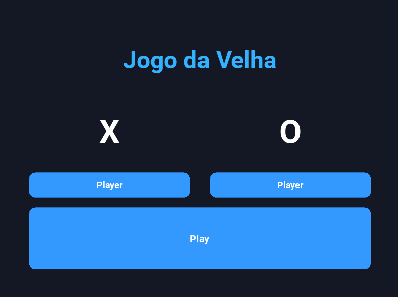
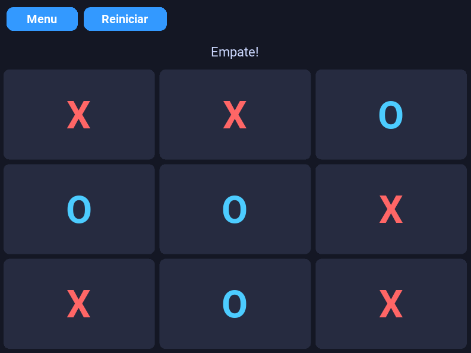

# Jogo da Velha — Com Minimax e Poda Alfa-Beta


## 🗂️ Estrutura do Projeto

```text
jogodavelha/
├── app.py                          # Ponto de entrada principal da aplicação gráfica
├── benchmark.py                    # Script para execução dos experimentos e métricas
├── README.md                       # Documentação do projeto
└── src/
    ├── board.py                    # Representação do tabuleiro, jogadas legais e verificação de término
    ├── controll.py                 # Controlador do fluxo da partida e alternância de turnos
    ├── game.py                     # Regras gerais e gerenciamento de estado do jogo
    ├── gui.py                      # Lógica da interface gráfica
    ├── menu.py                     # Tela inicial
    ├── style.kv                    # Definições visuais e layout da interface em Kivy
    ├── models/
    │   ├── __init__.py
    │   ├── minimax.py              # Implementação pura do algoritmo Minimax
    │   └── alpha_beta.py           # Implementação do Minimax com Poda Alfa-Beta
    └── players/
        ├── __init__.py
        ├── i_player.py             # Interface/classe base para os jogadores
        ├── player_human.py         # Implementação do jogador humano
        ├── player_minimax.py       # Agente autônomo controlado pelo Minimax
        └── player_alpha_beta.py    # Agente autônomo controlado pela Poda Alfa-Beta
```

---

## ⚙️ Pré-requisitos e Instalação

* **Python:** versão `3.10` ou superior.
* **Dependências:** Biblioteca `kivy` para a interface gráfica.

### Passo a passo para configurar o ambiente

1. Clone ou extraia o diretório do projeto e acesse a pasta raiz:
   ```bash
   cd <pasta do projeto>
   ```

2. Crie e ative um ambiente virtual:
   ```bash
   # Linux / macOS
   python3 -m venv venv
   source venv/bin/activate

   # Windows
   python -m venv venv
   venv\Scripts\activate
   ```

3. Instale as dependências:
   ```bash
   pip install -r requirements.txt
   ```

---

## 🚀 Como Executar

### 1. Iniciar o Jogo
Na raiz do projeto, execute o arquivo `app.py`:

```bash
python app.py
```

### 2. Executar os Experimentos de Benchmark
Para reproduzir os testes de comparação de nós visitados e tempo médio de execução nos tabuleiros não terminais, execute:

```bash
python benchmark.py
```

---

## 🎮 Em game





